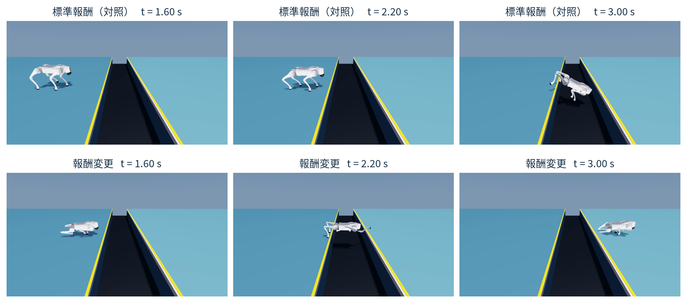

# Physical AI応用1講座 最終課題 — 四脚ロボットGo2の溝渡り（32667）

本検証は、物理シミュレーション（Isaac Lab / Newton）上の四脚ロボット Unitree Go2 を対象に、幅 85 cm・深さ 40 cm の溝を渡る動作が強化学習（PPO）の報酬設計の変更によって獲得できるかを調べた実験コードと再現環境である。溝幅を段階的に広げて事前学習した同じ学習済みモデルを出発点とし、同じ溝地形分布（幅 55–90 cm・深さ 40 cm）・同じ更新回数（400反復）・同じ乱数シード（`seed=42`）で追加学習した標準報酬モデル（`stage4-standard`、対照群）と報酬変更モデル（`stage4-balance`、変更群）の報酬比較を行う。本検証はすべてシミュレーション上の評価であり、実機検証ではない。

## 1. 主比較の結果（幅85 cm溝・開始位置3条件）

報酬変更モデルでは、定常歩行向けの安定性ペナルティ5項目を緩和し、前進と対岸支持を促す加点5項目および横ずれ・左右の傾きを抑える減点2項目（計7項目）を追加した。単一シード（`seed=42`）の学習済み重みに対し、溝へ進入する歩容位相の差を見るため開始位置を3条件（遠い `-0.15 m`・基準 `0.0 m`・近い `+0.15 m`）変えて評価した。通過成功数の分母「3」は開始位置の条件数であり、学習シード数は1である。

| モデル | 追加学習条件（共通：溝55–90 cm・400反復・`seed=42`） | 通過成功数 | 開始位置3条件の内訳と挙動 |
|---|---|---:|---|
| `stage4-standard`（対照） | 標準の不整地歩行報酬を維持 | **0 / 3** | 全3条件（`-0.15, 0.0, +0.15 m`）で溝内へ接触・落下し失敗 |
| `stage4-balance`（変更） | 安定性減点5項目を緩和＋前進・対岸支持など7項目を追加 | **2 / 3** | `-0.15 m` と基準 `0.0 m` で通過成功、近い `+0.15 m` は溝内接触で失敗 |

基準開始位置（`0.0 m`、`close`）の成功1試行を解析すると、手前岸に後脚を残したまま前脚を対岸へ接地させ、0.16秒（8ステップ）の両岸同時支持を作ってから後脚を引き寄せる跨ぎ動作が確認された。この両岸支持の定量解析は基準位置1試行のみを対象としており、全成功試行へ一般化するものではない。また、4脚すべてが浮いたまま跳び越える空中ジャンプの獲得は主張しない。



## 2. 最短確認・評価手順

### 経路A：既存記録の再集計（GPU不要）

リポジトリ内の公開JSONのハッシュ照合、通過成功数（`0 / 3` 対 `2 / 3`）、および基準位置（`close`）における両岸同時支持（0.16秒 / 8ステップ）の再集計は、GPUなしで実行できる。

```bash
git clone https://github.com/kiri-i/pai-go2-32667.git
cd pai-go2-32667
uv run python scripts/summarize_results.py
```

### 経路B：学習済みモデルによる新規推論（要GPU）

新規推論には Linux x86_64、CUDA対応GPU、`uv`、`ffmpeg` が必要である。Isaac Simの利用規約（EULA）を確認し同意した環境でのみ `export OMNI_KIT_ACCEPT_EULA=YES` を設定する。シミュレータ構築とモデル配布・取得は別手順に分かれている。学習手順や評価オプションの詳細は [`docs/reproduction.md`](docs/reproduction.md) に記載している。

```bash
# 1. シミュレータ環境（.local/sim）の構築とロボットUSDの取得
bash scripts/setup_sim.sh

# 2. 主比較2モデルの取得（既定2モデル、GPU不要で取得・SHA-256ハッシュ照合）
uv run python scripts/download_models.py

# 3. 幅85 cm溝・開始位置3条件での新規推論と動画出力
uv run python scripts/evaluate.py --checkpoint .local/models/stage4-standard.pt --gap-cm 85 --output runs/evaluation-85-standard --view readable
uv run python scripts/evaluate.py --checkpoint .local/models/stage4-balance.pt --gap-cm 85 --output runs/evaluation-85-balance --view readable
```

## 3. 本検証の限界と留保

- **複合報酬の個別寄与は未分離**：5係数の緩和と7項目の追加を一括適用しており、個別項目の寄与を切り分ける検証は実施していない。
- **単一シード・実機未確認**：追加学習は `seed=42` の1シードのみで、実機環境での有効性は未確認である。
- **同一重みでの再実行差**：同一の学習済み重み（`stage4-balance.pt`）でも再実行によって成否が変わった事実があり、その原因は特定されていない。新規評価の実行は元の収録とは別試行として扱い、基準位置1試行の両岸支持解析も他の成功試行へ一般化しない。

## 4. 配布物（Release `v1.0.0`）と詳細文書

報告書PDF・比較動画・学習済み6モデル（計約41 MB）は [GitHub Release `v1.0.0`](https://github.com/kiri-i/pai-go2-32667/releases/tag/v1.0.0)（各ファイルは `https://github.com/kiri-i/pai-go2-32667/releases/download/v1.0.0/<filename>`）で公開している。コード詳細、報酬係数、親モデルの系譜、旧評価との比較は以下を参照されたい。

- **報告書本文**：[`docs/report/report.md`](docs/report/report.md) / [`report.pdf`](https://github.com/kiri-i/pai-go2-32667/releases/download/v1.0.0/report.pdf)
- **補足資料（係数・諸元・旧評価）**：[`docs/report/appendix.md`](docs/report/appendix.md) / [`appendix.pdf`](https://github.com/kiri-i/pai-go2-32667/releases/download/v1.0.0/appendix.pdf)
- **比較動画（77.233秒）**：[`comparison.mp4`](https://github.com/kiri-i/pai-go2-32667/releases/download/v1.0.0/comparison.mp4)
- **モデル仕様・6モデル（約41 MB）**：[`docs/models.md`](docs/models.md)（`baseline.pt`, `first.pt`, `second.pt`, `stage3-exposure.pt`, `stage4-standard.pt`, `stage4-balance.pt`）
- **再現手順・来歴監査**：[`docs/reproduction.md`](docs/reproduction.md) / [`docs/provenance.md`](docs/provenance.md)
