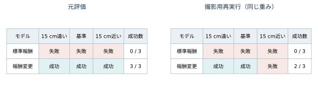

# Appendix：主要報酬項目一覧・実験諸元および評価履歴の補足

## A.1 報酬関数の主要項目一覧

各制御ステップ（$\Delta t = 0.02\,\text{s}$）における総報酬は $r_t = \Delta t \sum_{i} w_i f_i(s_t, a_t)$ で算出される。本検証の比較対象である標準報酬モデル（対照群）と報酬変更モデル（変更群）における主要16項目（維持4項目・緩和5項目・追加7項目）の重み係数 $w_i$ を表A1に示す。追加7項目の内訳は、前進および対岸支持を促す正報酬5項目と、横ずれおよび左右の傾きを抑える負報酬2項目である。

| 区分 | 主要報酬項目の内容 | 標準報酬モデル（対照群） | 報酬変更モデル（変更群） | 変更の役割・備考 |
| :--- | :--- | :---: | :---: | :--- |
| **維持した既存項目（4項）** | 平面速度追従 | $+1.5$ | $+1.5$ | 前進速度指令（$1.0\,\text{m/s}$）への追従維持 |
| | 旋回追従 | $+0.75$ | $+0.75$ | 初期方位の維持 |
| | 関節加速度の二乗 | $-2.5 \times 10^{-7}$ | $-2.5 \times 10^{-7}$ | 高周波振動の抑制 |
| | 足滞空時間 | $+0.01$ | $+0.01$ | 基礎的な歩容リズムの維持 |
| **係数緩和した既存項目（5項）** | 上下速度の二乗（`lin_vel_z_l2`） | $-2.0$ | $-0.2$ | 胴体座標系の上下動に対する減点を $1/10$ へ緩和 |
| | xy角速度の二乗 | $-0.05$ | $-0.01$ | ロール・ピッチ回転に対する減点を $1/5$ へ緩和 |
| | 身体高さ誤差の二乗（`base_height_l2`） | $-30.0$ | $-10.0$ | 平均地形高 $+0.4\,\text{m}$ 基準からの逸脱減点を $1/3$ へ緩和 |
| | 関節指令変化の二乗 | $-0.005$ | $-0.001$ | 素早い脚の振り出し・引き寄せに対する減点を $1/5$ へ緩和 |
| | トルクの二乗 | $-0.0002$ | $-0.0001$ | 溝通過時の支持トルクに対する減点を $1/2$ へ緩和 |
| **新規追加した加点項目（5項）** | 前進 | — | $+2.0$ | 溝通過方向（前方）への進行促進 |
| | 対岸支持の代理条件 | — | $+4.0$ | 固定位置 $x>2.5\,\text{m}$ での4脚通過・1脚以上接地支持・姿勢条件 |
| | 障害物付近の上向き速度 | — | $+2.0$ | 溝近傍での胴体沈み込み抑制（離陸検出・跳躍判定ではない連続報酬） |
| | 非接触中の前進 | — | $+1.0$ | 足先が非接触状態にある間の前方移動促進 |
| | 足先高さと前進 | — | $+2.0$ | 脚を高く保ちながら前方へ運ぶ動作の促進 |
| **新規追加した減点項目（2項）** | 横位置・横速度 | — | $-2.0$ | 進行軸に対する横方向の位置ずれ・横速度の抑制 |
| | 左右への傾き | — | $-1.0$ | ペナルティ緩和に伴うロール方向の傾きの抑制 |

---

## A.2 シミュレーション実験諸元と評価設定

本検証におけるシミュレーション環境、比較の出発点とした同じ学習済みモデルの由来、追加学習条件、および独立成功判定・接触解析の設定パラメータを表A2に示す。

| 区分 | 設定パラメータ・諸元 |
| :--- | :--- |
| **機体・物理・制御周期** | 四脚ロボット Unitree Go2（12関節）、物理演算周期 $200\,\text{Hz}$、方策制御周期 $50\,\text{Hz}$（$\Delta t = 0.02\,\text{s}$）、Newton 物理エンジンの材料設定1箇所のみ調整 |
| **入出力・評価時指令** | 観測235次元（身体状態等48次元＋周囲の地面高さ走査187次元）、行動12次元（関節目標指令）。エピソード開始後 $1.0\,\text{s}$ 間停止指令、以降は前進速度指令 $1.0\,\text{m/s}$ および初期方位保持指令のみを付与 |
| **出発点モデルの学習経緯** | 公式 Go2 不整地歩行 / PPO 設定でランダム重みから1500反復（4096並列環境、24ステップ/反復）の初期学習後、標準報酬のまま溝地形で段階的に継続学習した同一の学習済み重み |
| **主比較の追加学習条件** | 同じ学習済みモデルから同一条件で分岐、1024並列環境、400反復、24ステップ/反復、単一乱数シード `seed=42` |
| **主比較の学習地形** | 幅 $55\text{--}90\,\text{cm}$ 指定の16サンプル（実サンプル幅 $56.53\text{--}89.15\,\text{cm}$）、深さ $40\,\text{cm}$、カリキュラム無効（`curriculum=False`） |
| **評価地形・開始位置条件** | 幅 $85\,\text{cm}$（手前岸の縁 $x=1.50\,\text{m}$、対岸の縁 $x=2.35\,\text{m}$）・深さ $40\,\text{cm}$。開始位置は $15\,\text{cm}$ 遠い位置（$-0.15\,\text{m}$）、基準位置（$0.0\,\text{m}$）、$15\,\text{cm}$ 近い位置（$+0.15\,\text{m}$）の3条件 |
| **独立成功判定と接触定義** | 対岸の縁（`edge` $= 2.35\,\text{m}$）の単純通過（$x \ge 2.35\,\text{m}$）ではなく、独立成否判定器（`course_metrics.py`）の領域・姿勢条件 `inside` を連続 $1.0\,\text{s}$ 間維持し、かつ同窓内で支持履歴条件を満たした場合に成功と判定する。`inside` は全4脚の足先座標 $(x, y, z)$ が `edge + 0.05 < x < edge + length - 0.05`、`abs(y) < width/2 - 0.05`、`height - 0.02 < z < height + 0.15` を満たし、かつ `gravity_z < -0.7` であることと定義される（`edge` は対岸縁、`length` は対岸区間長、`width` は通路幅、`height` は対岸地面高さ、`gravity_z` は機体座標の投影重力 $z$ 成分）。支持履歴条件は、この `inside` 連続 $1.0\,\text{s}$ の窓内において、(1) 4脚それぞれが1回以上接地支持すること、(2) 窓内の $80\%$ 以上の時間で1脚以上が接地して機体を支持すること、の2条件である。接触解析における接地定義は鉛直接触反力 $F_z > 1\,\text{N}$ |

---

## A.3 元評価と映像・接触記録用再実行の比較

追加学習直後に実施した「元評価」と、同一の学習済み重み（`seed=42`）を変更せず映像および接触反力履歴の記録用に再実行した「今回評価（撮影時再実行）」の開始位置別成否を図A1に示す。

*図A1：同一の学習済み重み（`seed=42`）に対する元評価（標準報酬：成功 $0/3$、報酬変更：成功 $3/3$）と、映像・接触記録用の再実行（標準報酬：成功 $0/3$、報酬変更：成功 $2/3$）の開始位置3条件別比較。*

標準報酬モデル（対照群）は元評価・再実行ともに全3条件で溝内接触により失敗（成功 $0/3$）した。報酬変更モデル（変更群）は元評価において3条件すべてで成功（成功 $3/3$）した一方、同一重みの再実行では「$15\,\text{cm}$ 遠い位置（$-0.15\,\text{m}$）」と「基準位置（$0.0\,\text{m}$）」で成功し、「$15\,\text{cm}$ 近い位置（$+0.15\,\text{m}$）」で溝内接触により失敗（成功 $2/3$）した。本文では映像および接触履歴と直接対応する再実行結果（成功 $0/3$ 対 $2/3$）を主結果として報告し、同一重みにおける実行間差を本検証の限界として位置づけている。

---

## A.4 実装コード・再現資料

- 本検証のシミュレーション実装一式（溝地形生成、報酬関数設定、追加学習スクリプト、独立成否判定器、および接触反力・軌道解析コード）：https://github.com/kiri-i/pai-go2-32667
