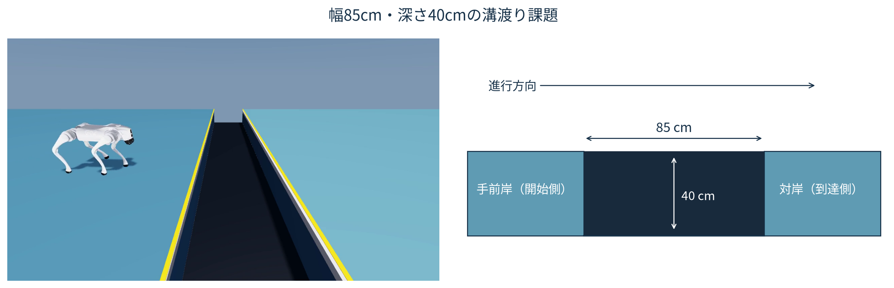
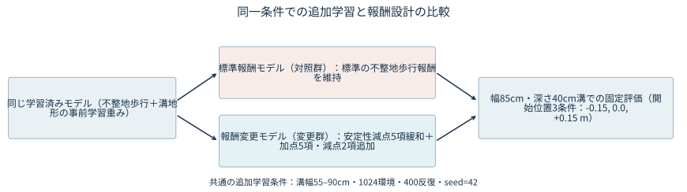
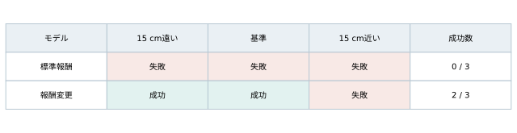
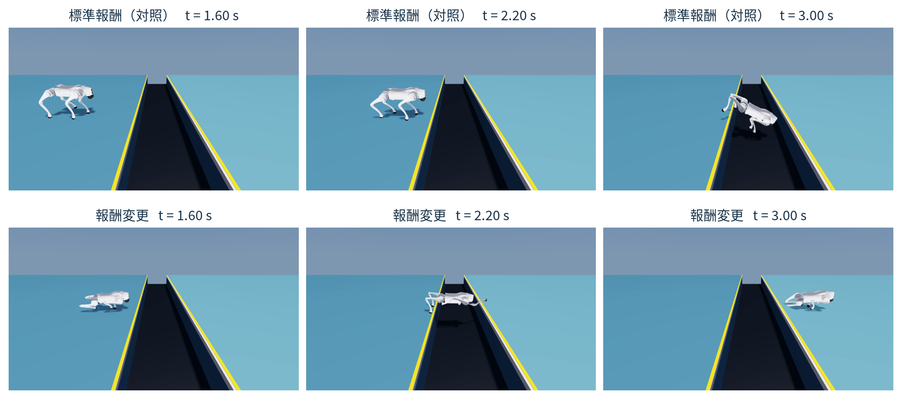
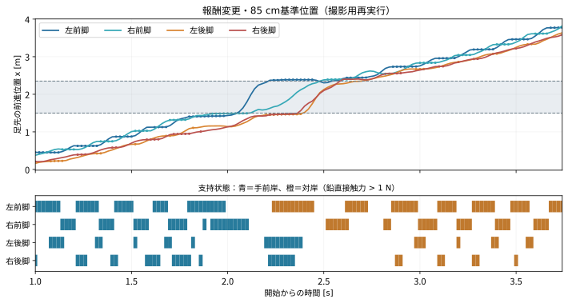

# 強化学習における報酬設計の変更を用いた四脚ロボットGo2の幅85cm溝渡り動作の獲得

**Physical AI応用1講座 最終課題「AI×ロボティクスによる創造的タスクの実現」｜受講生ID：32667**

---

## 1. 課題設定と検証の問い

本検証は、物理シミュレーション（Isaac Lab / Newton）上の四脚ロボット Unitree Go2（12関節）に、一定の前進速度指令（$1.0\,\text{m/s}$）を与えて幅 $85\,\text{cm}$・深さ $40\,\text{cm}$ の溝を渡らせる課題を対象とする（図1）。幅 $85\,\text{cm}$ を評価対象とする理由は、標準の不整地歩行報酬のまま同条件で追加学習したモデルが通過できなかった幅であるためである。本検証では、強化学習（Proximal Policy Optimization：PPO）による追加学習の報酬設計を変更することで、この幅 $85\,\text{cm}$ の溝を渡る動作を獲得できるかを検証する。

比較にあたっては、同じ学習済みモデルから出発し、同じ溝地形分布（幅 $55\text{--}90\,\text{cm}$）・同じ反復数（400反復）・同じ乱数シード（`seed=42`）で追加学習した以下の2系統を用いる。
- **標準報酬モデル（対照群）**：標準の不整地歩行報酬を維持したまま追加学習したモデル。
- **報酬変更モデル（変更群）**：定常歩行向けの安定性ペナルティ5項目を緩和し、前進・対岸支持を促す加点5項目と横ずれ・左右の傾きを抑える減点2項目（計7項目）を追加して追加学習したモデル。

評価時の成功基準は学習報酬とは独立に、「全4脚が対岸領域に入り、足で機体を支えつつ胴体姿勢を連続 $1.0\,\text{s}$ 間維持すること」と定義する。

*図1：幅 $85\,\text{cm}$・深さ $40\,\text{cm}$ の溝渡り課題と進行方向（右は地形断面図）。手前岸から前進指令 $1.0\,\text{m/s}$ で進入し、4脚が対岸領域に入って足で機体を支えつつ姿勢を連続 $1.0\,\text{s}$ 間維持すれば成功と判定する。*

---

## 2. シミュレーション構成と報酬変更の設計

### 2.1 検証環境と同一条件での追加学習設定

比較の出発点となる学習済みモデルは、公式の不整地歩行設定でランダム初期化から歩行を初期学習した後、標準報酬のまま溝地形で継続学習した重みである。この同じ学習済みモデルから、幅 $55\text{--}90\,\text{cm}$（深さ $40\,\text{cm}$、カリキュラム無効）の溝地形分布上で1024並列環境・400反復・`seed=42` の条件を揃えて標準報酬モデルと報酬変更モデルを分岐させ、幅 $85\,\text{cm}$ の固定溝で評価した（図2）。

*図2：本検証の比較設計。同じ学習済みモデルから出発し、同じ溝地形分布（幅 $55\text{--}90\,\text{cm}$）・400反復・`seed=42` の共通条件で標準報酬モデルと報酬変更モデルを追加学習させ、幅 $85\,\text{cm}$ の溝で固定評価する。*

シミュレーションの物理演算周期は $200\,\text{Hz}$、方策の制御周期は $50\,\text{Hz}$（$\Delta t = 0.02\,\text{s}$）である。方策は235次元の観測（胴体状態・関節状態・直前行動・速度指令の48次元と、機体周囲の地面高さ走査187次元）を入力とし、12関節の目標指令を出力する。評価時は開始後 $1.0\,\text{s}$ 間停止させて初期姿勢を安定させた後、前進速度指令 $1.0\,\text{m/s}$ と初期方位保持指令を与える。対岸の判定領域（対岸の縁 $x = 2.35\,\text{m}$ から内側へマージンをとった領域）へ全4脚が入った後の連続 $1.0\,\text{s}$ の支持窓において、(1) 位置・足先高さ・胴体姿勢の条件維持、(2) 4脚それぞれの1回以上の対岸接地（鉛直接触反力 $F_z > 1\,\text{N}$）、(3) 窓内の $80\%$ 以上の時間における1脚以上の接地支持、の3条件をすべて満たした場合のみ成功と判定する（厳密な判定条件および実験諸元はAppendix A.2を参照）。

### 2.2 対照群の失敗現象と報酬変更の設計意図

標準報酬モデルを幅 $85\,\text{cm}$ の溝で評価すると、ロボットは溝の手前で停止せず前進指令に従って溝へ進入したものの、溝の内部へ接触・落下して通過に失敗した。

標準の不整地歩行報酬では、平地や小規模な凹凸で定常歩容を保つため、胴体の上下速度、ロール・ピッチ角速度、基準高さからの誤差、関節指令変化率、およびトルクに強い二乗ペナルティが課されている。幅 $85\,\text{cm}$ の溝を渡るには、前脚を大きく振り出し、胴体の上下動やピッチ変化を伴いながら後脚を引き寄せる運動が必要となるが、定常歩行向けの強い安定性減点がその探索を妨げているという設計仮説を立てた。また、姿勢や高さの減点を緩めるだけでは、進行軸からの横ずれやロール方向の崩れが生じやすくなる。

そこで各ステップの報酬 $r_t = \Delta t \sum_{i} w_i f_i(s_t, a_t)$ における主要16項目のうち、平面速度追従（$+1.5$）など基礎歩容の4項目を維持した上で、既存5項目のペナルティ緩和と新規7項目（前進・対岸支持を促す加点5項目＋横ずれ・傾きを抑える減点2項目）の追加を行った。代表的な変更項目と設計意図を表1に示す（主要16項目の係数一覧はAppendix A.1を参照）。

| 設計区分 | 代表的な報酬項目 | 標準報酬（対照群） | 報酬変更（変更群） | 設計意図・役割 |
| :--- | :--- | :---: | :---: | :--- |
| **1. 既存安定性ペナルティの緩和（5項）** | 上下速度の二乗（`lin_vel_z_l2`） | $-2.0$ | $-0.2$ | 溝通過時の胴体上下動に対する減点を緩和 |
| | 身体高さ誤差の二乗（`base_height_l2`） | $-30.0$ | $-10.0$ | 基準高さからの逸脱減点を緩和 |
| | 関節指令変化の二乗 / xy角速度の二乗 | $-0.005$ / $-0.05$ | $-0.001$ / $-0.01$ | 素早い脚の振り出しとピッチ姿勢変化への減点を緩和 |
| **2. 溝通過・対岸支持の加点追加（5項）** | 対岸支持の代理条件 | — | $+4.0$ | $x>2.5\,\text{m}$ での4脚通過・接地支持・姿勢維持を誘導 |
| | 前進 / 足先高さと前進 / 非接触中の前進 | — | $+2.0$ / $+2.0$ / $+1.0$ | 脚を高く保ちながら前方へ運ぶ動作を促進 |
| | 障害物付近の上向き速度 | — | $+2.0$ | 溝近傍での胴体沈み込みを抑制（連続報酬） |
| **3. 直進・横安定性の減点追加（2項）** | 横位置・横速度 / 左右への傾き | — | $-2.0$ / $-1.0$ | 緩和に伴う横ずれとロール方向の傾きを抑制 |

---

## 3. シミュレーション評価結果と動作解析

### 3.1 開始位置3条件における溝通過成否の比較

溝の手前の縁に到達する際の歩容位相や助走距離の差が成否に影響するため、単一の初期位置での偶発的な通過と区別する目的で、同一の学習済み重み（`seed=42`）に対し開始位置を「$15\,\text{cm}$ 遠い位置（$-0.15\,\text{m}$）」「基準位置（$0.0\,\text{m}$）」「$15\,\text{cm}$ 近い位置（$+0.15\,\text{m}$）」の3条件に変えて評価した（成績表記の分母3は開始位置3条件を指す）。

図3に開始位置3条件での評価結果を示す。標準報酬モデル（対照群）は全3条件で溝の内部に接触・落下し、通過は成功 $0/3$ であった。一方、報酬変更モデル（変更群）は「$15\,\text{cm}$ 遠い位置」と「基準位置」の2条件で対岸進入後の連続 $1.0\,\text{s}$ 間支持条件を満たして通過に成功し、「$15\,\text{cm}$ 近い位置」の1条件のみ溝内接触により失敗した（成功 $2/3$）。

*図3：幅 $85\,\text{cm}$・深さ $40\,\text{cm}$ の溝における開始位置3条件（$-0.15\,\text{m}$、$0.0\,\text{m}$、$+0.15\,\text{m}$）での通過成否。標準報酬モデルは成功 $0/3$、報酬変更モデルは成功 $2/3$（$-0.15\,\text{m}$ と $0.0\,\text{m}$ で成功、$+0.15\,\text{m}$ で失敗）となった。*

### 3.2 動作比較と足先軌道・接触反力による両岸同時支持の確認

同じ基準開始位置（$0.0\,\text{m}$）条件における標準報酬モデルと報酬変更モデルの各試行の動作抜粋を図4に、図4下段の報酬変更モデルの画像と同一試行について解析した4脚の足先前後座標 $x(t)$ と接地支持ラスタ（$F_z > 1\,\text{N}$）を図5に示す。溝の手前岸の縁は $x = 1.50\,\text{m}$、対岸の縁は $x = 2.35\,\text{m}$ である。

*図4：基準開始位置（$0.0\,\text{m}$、近接視点）における標準報酬モデル（上段）と報酬変更モデル（下段）の同一時刻（左から $t = 1.60,\ 2.20,\ 3.00\,\text{s}$）の動作比較。上段は溝内部へ接触・落下し、下段は対岸へ前脚をかけて通過し支持を維持する。*

*図5：図4下段と同一の基準開始位置（$0.0\,\text{m}$）試行における報酬変更モデルの4脚足先座標 $x(t)$ と接地支持ラスタ（$\Delta t = 0.02\,\text{s}$）。手前岸（$x \le 1.50\,\text{m}$）の接地を青、対岸（$x \ge 2.35\,\text{m}$）の接地を橙で示す。対岸の前脚と手前岸の後脚が同時に接地して機体を支える両岸同時支持が計 $0.16\,\text{s}$ 確認された。*

図4および図5から、報酬変更モデルでは手前岸（青）に後脚を残した状態で前脚を溝区間（$1.50 < x < 2.35\,\text{m}$）の向こう側へ振り出し、対岸の縁（橙）へ接地させていることが確認できる。この移行中、対岸の前脚と手前岸の後脚が同時に $F_z > 1\,\text{N}$ の接触反力を発生する「両岸同時支持」が計 $0.16\,\text{s}$（8制御ステップ分）成立しており、その後に後脚を対岸へ引き寄せて全4脚が対岸の判定領域に入り、連続 $1.0\,\text{s}$ 間の成功判定条件を満たしている。すなわち、確認された通過挙動は両岸にまたがって身体を支える跨ぎ動作であり、4脚すべてが浮いたまま溝全体を空中飛越した証拠は見られない。

---

## 4. 考察と本検証の限界

同じ学習済みモデルから同一の溝地形分布（$55\text{--}90\,\text{cm}$）と学習反復数（400反復、`seed=42`）で追加学習した比較において、標準報酬モデルが成功 $0/3$ であったのに対し、報酬変更モデルは開始位置3条件中2条件（成功 $2/3$）で幅 $85\,\text{cm}$ の溝を通過し、接触解析を実施した基準位置（$0.0\,\text{m}$、近接視点）の1試行では計 $0.16\,\text{s}$ の両岸同時支持を伴う跨ぎ動作が確認された。

本検証の結果を解釈する上での限界と留保を以下に示す。
1. **報酬各項の寄与と失敗機序の未分離**：既存5項目の緩和と新規7項目（加点5項目・減点2項目）の追加を一括で適用しており、個別項目の除外検証（アブレーション）は行っていない。また、対照群について観測された事実は溝内接触による失敗であり、個々の報酬項目の因果的寄与や内部の失敗機序は分離されていない。
2. **同一重みでの再実行差と開始位置への感度**：報酬変更モデルの同一重みであっても、学習直後の元評価では成功 $3/3$ であった一方、映像・接触記録用の実行では開始位置が $15\,\text{cm}$ 近い条件（$+0.15\,\text{m}$）で溝内接触により失敗し成功 $2/3$ となった（元評価との比較はAppendix A.3を参照）。開始位置が近い条件では初期停止（$1.0\,\text{s}$）から溝の縁に達するまでの助走距離が短く、速度や歩容位相が整う余裕が小さい可能性があり、同一重みでも実行間で成否が揺らぐ感度が確認された。
3. **単一シード・固定反復数の制約**：追加学習は `seed=42` の1シード・400反復のみで実施しており、乱数シード間の分散や400反復を超える長期学習時の挙動は未検証である。
4. **訓練分布内の内挿評価とシミュレーション限定の検証**：評価幅 $85.00\,\text{cm}$ は訓練サンプル（実幅 $56.53\text{--}89.15\,\text{cm}$）の内挿範囲内にあり、$90\,\text{cm}$ を超える外挿性能や、アクチュエータ遅延・足先滑り・センサ誤差を伴う実機環境での有効性は未確認である。

---

## 5. 結論

本検証では、物理シミュレーション上の四脚ロボット Go2 において、同じ学習済みモデルから同一条件（溝幅 $55\text{--}90\,\text{cm}$、400反復、`seed=42`）で標準報酬モデルと報酬変更モデルを追加学習させ、幅 $85\,\text{cm}$・深さ $40\,\text{cm}$ の溝渡りを開始位置3条件で比較した。その結果、標準報酬モデルが全条件で溝内へ接触・落下して失敗（成功 $0/3$）したのに対し、安定性ペナルティ5項目を緩和し前進・対岸支持の加点5項目と横ずれ・傾き抑制の減点2項目を追加した報酬変更モデルでは、開始位置3条件中2条件（成功 $2/3$）で幅 $85\,\text{cm}$ の溝を通過でき、接触解析を行った基準位置（$0.0\,\text{m}$、近接視点）の1試行において前脚を対岸へ接地させて手前岸の後脚とともに計 $0.16\,\text{s}$ の両岸同時支持を作る跨ぎ動作が確認された。
